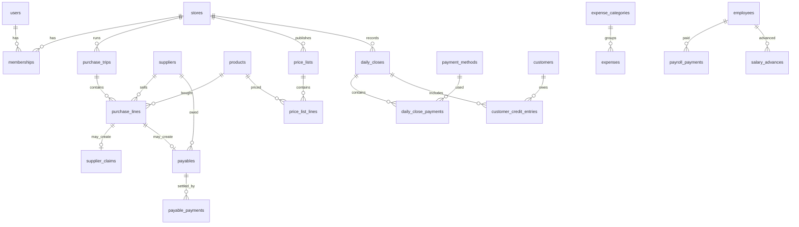

# Domain Model — Tierra Andina

Source of truth for the business rules and the database design.
Code must follow this document; if the business changes, update this document first.
Vocabulary follows the glossary in `CLAUDE.md` §5.

---

## 1. The business in one page

Tierra Andina is a fruit and vegetable shop in a market in Caracas, Venezuela.
The owner does not work at the shop; two employees run it, one of them as shop manager.

**Weekly cycle**

| Day       | Who              | What happens                                                                                                  |
| --------- | ---------------- | ------------------------------------------------------------------------------------------------------------- |
| Monday    | Owner            | Purchase trip to the wholesale market (Coche). Buys stall by stall.                                           |
| Monday    | Owner            | Calculates cost and sale price for every product bought.                                                      |
| Tuesday   | Manager          | Receives the new price list and updates prices at the shop.                                                   |
| Thursday  | Manager → Owner  | Manager reports what is missing (shopping list). Owner checks the bank balance.                               |
| Thursday  | Owner + receiver | Second purchase trip. Each stall sends goods to the owner's truck, where a trusted receiver confirms arrival. |
| Thursday  | Owner            | Optional new price list, only if the exchange rate or costs moved.                                            |
| Every day | Manager          | Daily close: card terminal, mobile payment, cash Bs, cash USD, customer credit.                               |
| As needed | Owner            | Pays local suppliers who give credit (bread, bags, bananas).                                                  |
| Saturday  | Owner            | Pays employees and closes the week.                                                                           |
| Sunday    | Owner            | Reviews the week's sales and results.                                                                         |

**Selling patterns:** weekends sell more, especially around the 15th and the last day of the
month (paydays). Cash starts at zero every day; the previous day's cash is kept or deposited.

---

## 2. Money and exchange rates

- Suppliers quote prices in **USD** and charge in Bs at their own rate: usually the
  official BCV rate, sometimes rounded one point higher.
- Sale prices are defined in **USD** and converted to Bs with a **sale rate** chosen by the
  owner, always above the BCV rate to protect against devaluation.
- Three rates exist and must never be confused:

| Rate            | Set by                  | Scope                 |
| --------------- | ----------------------- | --------------------- |
| `bcv_rate`      | Central bank (official) | One per day           |
| `supplier_rate` | Each stall              | One per purchase line |
| `sale_rate`     | Owner                   | One per price list    |

- Every stored amount keeps: the USD amount, the Bs amount, and the rate used.
- All money, rates, quantities and margins are `numeric(14,4)`. Calculations use decimal.js.

---

## 3. Purchasing and pricing rules

### 3.1 Purchase units

| Purchase unit | Example                     | Sale unit      | Usable quantity                   |
| ------------- | --------------------------- | -------------- | --------------------------------- |
| `crate`       | Tomato, ~24 kg (varies)     | `kg`           | gross kg − shrinkage kg           |
| `bundle`      | Cilantro: 28 bunches, ~2 kg | `unit` (bunch) | gross bunches − shrinkage bunches |
| `bundle`      | Spring onion                | `kg`           | gross kg − shrinkage kg           |
| `kg`          | Taro, celery: 10 kg         | `kg`           | gross kg − shrinkage kg           |

- Gross quantity varies per purchase and is entered every time.
- **Shrinkage** is decided per purchase line (the system suggests the last value used).
- **Margin** is decided per product and can change on every purchase (suggests the last value).

### 3.2 Pricing formulas

```
usable_quantity   = gross_quantity − shrinkage
real_cost_usd     = quoted_price_usd × supplier_rate / bcv_rate
unit_cost_usd     = real_cost_usd / usable_quantity
sale_price_usd    = round_up(unit_cost_usd × (1 + margin), usd_rounding_step)
sale_price_bs     = round_up(sale_price_usd × sale_rate, bs_rounding_step)
```

- `real_cost_usd` captures the supplier's rate rounding so it never silently eats the margin.
- If goods arrive incomplete (§4), costing uses the **received** quantity.

### 3.3 Reference cases (must be covered by tests)

| Case              | Input                                                                              | Expected                                      |
| ----------------- | ---------------------------------------------------------------------------------- | --------------------------------------------- |
| Tomato crate      | 20 USD, 24 kg, shrinkage 2, supplier_rate = bcv_rate = 200, margin 0.50, step 0.05 | usable 22 · unit cost 0.9091 · price 1.40 USD |
| Supplier rounding | Same, supplier_rate 201                                                            | real cost 20.10 USD                           |
| Cilantro bundle   | 10 USD, 28 bunches, shrinkage 2, margin 0.50, step 0.05                            | usable 26 · price 0.60 USD                    |
| Bs conversion     | 1.40 USD, sale_rate 210, Bs step 1                                                 | 294 Bs                                        |
| Invalid shrinkage | shrinkage ≥ gross                                                                  | error                                         |

### 3.4 Price lists

- A price list is generated after a purchase trip and published to the shop.
- Thursday's list is optional. When the BCV rate rises, the system proposes updated prices;
  the owner decides whether to publish.
- Every published list is kept, so the price in force on any date is known.

---

## 4. Truck receipt (purchase trips)

At the wholesale market the owner buys stall by stall. Each stall sends the goods to the truck,
where a **receiver** checks what arrives.

| Receipt status | Set by   | Meaning                                                        |
| -------------- | -------- | -------------------------------------------------------------- |
| `pending`      | System   | Line registered; receiver is notified (product, packs, stall)  |
| `received`     | Receiver | Arrived complete                                               |
| `partial`      | Receiver | Arrived incomplete; receiver records received packs and a note |
| `missing`      | Receiver | Did not arrive                                                 |

- The owner sees live which lines are in the truck and which are pending.
- Before closing the trip, the system warns about pending lines.
- `partial` and `missing` lines create a **supplier claim** for the difference.
- Because each line can come from a different stall, **supplier, supplier rate and payment
  status belong to the purchase line**, not to the trip.
- The receiver role sees only the current trip, product and packs (prices hidden by default,
  configurable).

---

## 5. Daily close

- The manager submits one close per business day from the phone.
- Payment methods are records, not columns, so new methods can be added without migrations.
  Initial methods: card terminal (Bs), mobile payment (Bs), cash Bs, cash USD.
- Customer credit sold that day is recorded with the customer's name and amount.
- `total_usd` = sum of every payment converted at the close's rate + credit sold.
- Cash destination: `kept` or `deposited`.
- Once submitted, only the owner can edit a close.

---

## 6. Debts, expenses and payroll

- **Customer credit:** entries of type `credit` (sold on credit) and `payment` (customer pays).
  Balance per customer = credits − payments.
- **Payables:** amounts owed to suppliers (purchase lines on credit, bread, bags, bananas),
  with partial payments.
- **Expenses:** fixed (recurring templates) and variable (bags, unloading labor, drinking
  water, coffee, sugar, bleach). Categories are records, editable by the owner.
- **Payroll:** weekly salary per employee, paid on Saturday, with advances during the week.

---

## 7. Roles

| Role       | Can                                                                                                |
| ---------- | -------------------------------------------------------------------------------------------------- |
| `owner`    | Everything                                                                                         |
| `manager`  | View current price list, submit daily close, add customer credit payments, add shopping list items |
| `receiver` | View the current purchase trip and set receipt status                                              |

Roles are assigned per store through memberships, so a person can have different roles in
different stores.

---

## 8. Scalability decisions

| Decision                                                               | Why                                                     |
| ---------------------------------------------------------------------- | ------------------------------------------------------- |
| `stores` table + `store_id` on every operational table                 | A second shop needs no redesign                         |
| Payment methods, expense categories, product categories as tables      | New values without migrations                           |
| Settings as key/value per store (`jsonb`)                              | New configuration without migrations                    |
| Supplier, rate and payment status per purchase line                    | Matches stall-by-stall buying                           |
| Price lists versioned, never overwritten                               | Historical prices and margins stay correct              |
| UUID v7 primary keys generated in the app (`Bun.randomUUIDv7()`)       | Time-ordered, index-friendly, safe for offline creation |
| `timestamptz` for instants, `date` for business days (America/Caracas) | No timezone bugs in closes and reports                  |
| Soft delete (`is_active`) on catalogs; never on financial records      | History is preserved                                    |
| Audit log of every write                                               | Know who changed what, without the owner at the shop    |
| Reports computed from data (views/queries), not stored                 | One source of truth                                     |
| Sales, sale lines and inventory reserved for phase 5 (POS)             | Product and price-list ids are already compatible       |

---

## 9. Database design

Conventions: tables plural snake_case; columns snake_case; every table has `id uuid` (v7),
`created_at timestamptz`, `updated_at timestamptz`; editable tables add `created_by` and
`updated_by` (→ users). Money columns end in `_usd` or `_bs`; rates end in `_rate`.

### 9.1 Organization and access

| Table                          | Key columns                                                                                                |
| ------------------------------ | ---------------------------------------------------------------------------------------------------------- |
| `stores`                       | name, address, timezone (default `America/Caracas`), is_active                                             |
| `users` (+ Better Auth tables) | name, email, … (managed by Better Auth)                                                                    |
| `memberships`                  | user_id, store_id, role (`owner`/`manager`/`receiver`), is_active · unique (user_id, store_id)             |
| `settings`                     | store_id, key, value (jsonb) · unique (store_id, key)                                                      |
| `push_subscriptions`           | user_id, endpoint, keys (jsonb), user_agent                                                                |
| `audit_logs`                   | store_id, user_id, table_name, record_id, action (`insert`/`update`/`delete`), changes (jsonb), created_at |

Initial settings: `usd_rounding_step = 0.05`, `bs_rounding_step = 1`,
`sale_rate_mode = manual` (or `bcv_plus_pct`), `sale_rate_markup_pct = 0`,
`default_margin = 0.50`, `receiver_can_see_prices = false`.

### 9.2 Catalog

| Table                | Key columns                                                                                                                                      |
| -------------------- | ------------------------------------------------------------------------------------------------------------------------------------------------ |
| `product_categories` | name (fruit, vegetable, greens, tubers, other), sort_order                                                                                       |
| `products`           | name, category_id, purchase_unit (`crate`/`bundle`/`kg`), sale_unit (`kg`/`unit`), default_pack_quantity, last_shrinkage, last_margin, is_active |
| `suppliers`          | name, kind (`wholesale_stall`/`local`), phone, stall_reference, is_active                                                                        |

### 9.3 Exchange rates

| Table            | Key columns                                                                                                 |
| ---------------- | ----------------------------------------------------------------------------------------------------------- |
| `exchange_rates` | store_id (null for BCV), business_date, kind (`bcv`/`sale`), value · unique (store_id, business_date, kind) |

### 9.4 Purchasing

| Table                 | Key columns                                                                                                                                                                                                                                                                                                                                                                        |
| --------------------- | ---------------------------------------------------------------------------------------------------------------------------------------------------------------------------------------------------------------------------------------------------------------------------------------------------------------------------------------------------------------------------------- |
| `purchase_trips`      | store_id, business_date, bcv_rate, status (`open`/`closed`), total_usd, total_bs, note                                                                                                                                                                                                                                                                                             |
| `purchase_lines`      | trip_id, supplier_id, stall_reference, product_id, purchase_unit, packs, gross_quantity, shrinkage, usable_quantity, quoted_price_usd, supplier_rate, real_cost_usd, unit_cost_usd, margin, sale_price_usd, payment_status (`paid`/`credit`), receipt_status (`pending`/`received`/`partial`/`missing`), received_packs, received_quantity, received_by, received_at, receipt_note |
| `supplier_claims`     | purchase_line_id, supplier_id, missing_packs, amount_usd, status (`open`/`resolved`/`written_off`), resolution_note                                                                                                                                                                                                                                                                |
| `shopping_list_items` | store_id, product_id, requested_by, note, status (`open`/`bought`/`dropped`), purchase_line_id (nullable)                                                                                                                                                                                                                                                                          |

### 9.5 Pricing

| Table              | Key columns                                                                                                                                    |
| ------------------ | ---------------------------------------------------------------------------------------------------------------------------------------------- |
| `price_lists`      | store_id, trip_id (nullable), sale_rate, status (`draft`/`published`), published_at, published_by                                              |
| `price_list_lines` | price_list_id, product_id, unit_cost_usd, margin, price_usd, price_bs, source_purchase_line_id (nullable) · unique (price_list_id, product_id) |

### 9.6 Daily close

| Table                  | Key columns                                                                                                                                                                             |
| ---------------------- | --------------------------------------------------------------------------------------------------------------------------------------------------------------------------------------- |
| `payment_methods`      | name, currency (`USD`/`VES`), sort_order, is_active                                                                                                                                     |
| `daily_closes`         | store_id, business_date, submitted_by, rate, total_usd, credit_sold_bs, cash_destination (`kept`/`deposited`), status (`submitted`/`approved`), note · unique (store_id, business_date) |
| `daily_close_payments` | daily_close_id, payment_method_id, amount, amount_usd · unique (daily_close_id, payment_method_id)                                                                                      |

### 9.7 Receivables, payables, expenses, payroll

| Table                     | Key columns                                                                                                        |
| ------------------------- | ------------------------------------------------------------------------------------------------------------------ |
| `customers`               | store_id, name, phone, is_active                                                                                   |
| `customer_credit_entries` | customer_id, kind (`credit`/`payment`), business_date, amount_bs, amount_usd, rate, daily_close_id (nullable)      |
| `payables`                | store_id, supplier_id, concept, amount_usd, issued_on, due_on, purchase_line_id (nullable), status (`open`/`paid`) |
| `payable_payments`        | payable_id, paid_on, amount_usd, amount_bs, rate, payment_method_id                                                |
| `expense_categories`      | name, kind (`fixed`/`variable`), is_active                                                                         |
| `recurring_expenses`      | store_id, category_id, amount_usd, frequency (`weekly`/`monthly`), is_active                                       |
| `expenses`                | store_id, category_id, business_date, amount_usd, amount_bs, rate, recurring_expense_id (nullable), note           |
| `employees`               | store_id, name, job_title, weekly_salary_usd, user_id (nullable), is_active                                        |
| `payroll_payments`        | employee_id, week_start, salary_usd, advances_usd, paid_usd, paid_on, note                                         |
| `salary_advances`         | employee_id, paid_on, amount_usd, amount_bs, rate, payroll_payment_id (nullable)                                   |

### 9.8 Entity overview



### 9.9 Indexes and constraints

- Index every foreign key and every `business_date`.
- `CHECK` constraints: amounts ≥ 0, rates > 0, `shrinkage < gross_quantity`,
  `received_packs <= packs`, `margin >= 0`.
- Uniques listed in the tables above.

### 9.10 Seed data

- One store: "Tierra Andina — Mercado AVEPAC, Caricuao".
- Owner user from `SEED_OWNER_EMAIL` / `SEED_OWNER_PASSWORD`, with `owner` membership.
- Settings defaults (§9.1).
- Payment methods: card terminal (VES), mobile payment (VES), cash Bs (VES), cash USD (USD).
- Product categories (§9.2).
- Expense categories: bags, unloading labor, drinking water, coffee, sugar, bleach (variable).

---

## 10. Open questions (current defaults)

| Question                                            | Default until answered                            |
| --------------------------------------------------- | ------------------------------------------------- |
| Does the receiver check packs only, or also weight? | Both fields exist; weight optional                |
| Is the stall paid before or after delivery?         | `payment_status` per line, independent of receipt |
| Does Monday's trip also use truck receipt?          | Feature available every trip; optional per trip   |
| Can the receiver see prices?                        | No (`receiver_can_see_prices = false`)            |
| Price rounding rule                                 | 0.05 USD and 1 Bs, rounding up (settings)         |
| How is the sale rate set?                           | Manual, BCV shown as reference                    |
