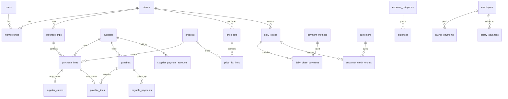

# Domain Model — Tierra Andina

Source of truth for the business rules and the database design.
Code must follow this document; if the business changes, update this document first.
Vocabulary follows the glossary in `CLAUDE.md` §5.

---

## 1. The business in one page

Tierra Andina is a fruit and vegetable shop in a market in Caracas, Venezuela.
The owner does not work at the shop; two employees run it, one of them as shop manager.

**Weekly cycle**

| Day       | Who              | What happens                                                                                                  |
| --------- | ---------------- | ------------------------------------------------------------------------------------------------------------- |
| Monday    | Owner            | Purchase trip to the wholesale market (Coche). Buys stall by stall.                                           |
| Monday    | Owner            | Calculates cost and sale price for every product bought.                                                      |
| Tuesday   | Manager          | Receives the new price list and updates prices at the shop.                                                   |
| Thursday  | Manager → Owner  | Manager reports what is missing (shopping list). Owner checks the bank balance.                               |
| Thursday  | Owner + receiver | Second purchase trip. Each stall sends goods to the owner's truck, where a trusted receiver confirms arrival. |
| Thursday  | Owner            | Optional new price list, only if the exchange rate or costs moved.                                            |
| Every day | Manager          | Daily close: card terminal, mobile payment, cash Bs, cash USD, customer credit.                               |
| As needed | Owner            | Pays local suppliers who give credit (bread, bags, bananas).                                                  |
| Saturday  | Owner            | Pays employees and closes the week.                                                                           |
| Sunday    | Owner            | Reviews the week's sales and results.                                                                         |

**Selling patterns:** weekends sell more, especially around the 15th and the last day of the
month (paydays). Cash starts at zero every day; the previous day's cash is kept or deposited.

---

## 2. Money and exchange rates

- Suppliers quote prices in **USD** and charge in Bs at the **Coche market rate** of the day
  (`market_rate`), sometimes a stall charges its own rate.
- Sale prices are defined in **USD** and converted to Bs with a **sale rate** chosen by the
  owner, always above the BCV rate to protect against devaluation.
- Four rates exist and must never be confused. The owner enters the BCV, Coche and sale rates
  of each day by hand (screen "Tasas del día"). The home screen and that form also show the
  official BCV USD rate read from the Banco Central de Venezuela homepage (`GET /exchange-rates/official`).
  It does not replace the stored rate until the owner presses "Usar esta tasa" and saves:

| Rate            | Set by                  | Scope                                                      |
| --------------- | ----------------------- | ---------------------------------------------------------- |
| `bcv_rate`      | Central bank (official) | One per day                                                |
| `market_rate`   | Owner (Coche market)    | One per day; copied to each purchase trip                  |
| `supplier_rate` | Each stall              | One per purchase line (defaults to the trip `market_rate`) |
| `sale_rate`     | Owner                   | One per price list                                         |

- Every amount of money that changes hands (payments, expenses, advances, credit entries, what
  is paid to a stall) keeps: the USD amount, the Bs amount, and the rate used. Obligations and
  templates denominated in USD (payables, recurring expenses, salaries, claims) store USD only.
- All money, rates, quantities and margins are `numeric(14,4)`. Calculations use decimal.js.

---

## 3. Purchasing and pricing rules

### 3.1 Purchase units

| Purchase unit | Example                     | Sale unit      | Usable quantity                   |
| ------------- | --------------------------- | -------------- | --------------------------------- |
| `crate`       | Tomato, ~24 kg (varies)     | `kg`           | gross kg − shrinkage kg           |
| `bundle`      | Cilantro: 28 bunches, ~2 kg | `unit` (bunch) | gross bunches − shrinkage bunches |
| `bundle`      | Spring onion                | `kg`           | gross kg − shrinkage kg           |
| `kg`          | Taro, celery: 10 kg         | `kg`           | gross kg − shrinkage kg           |

- Gross quantity varies per purchase and is entered every time. Crates are optional: when
  they are typed, the form pre-fills packs × default pack quantity until the weighed
  quantity is typed. A line with no crates stores `packs` as null.
- **Shrinkage** belongs to the product (`last_shrinkage`). A purchase copies it onto the
  line so older purchases keep the number they were costed with, and does not change the
  product (owner, 2026-10-17).
- **Margin** is decided per product and can change on every purchase (suggests the last value).

### 3.2 Pricing formulas

```
usable_quantity   = gross_quantity − shrinkage
real_cost_usd     = quoted_price_usd × supplier_rate / bcv_rate
unit_cost_usd     = real_cost_usd / usable_quantity
sale_price_usd    = round_up(unit_cost_usd × (1 + margin), usd_rounding_step)
sale_price_bs     = round_up(sale_price_usd × sale_rate, bs_rounding_step)
```

- `quoted_price_usd` is the total of the purchase line (3 crates at 20 USD → 60 USD), and the
  stall is paid `quoted_price_usd × supplier_rate` in Bs (stored as `amount_bs`).
- `real_cost_usd` captures the supplier's rate rounding so it never silently eats the margin.
- The price is typed in dollars. `supplier_rate` is the trip's `market_rate` (Coche rate of
  the day): the form does not ask for a per-stall rate (owner, 2026-10-17). `bcv_rate` and
  `market_rate` are copied into the trip from the day's rates when it is opened.
- Trip totals: `total_usd = Σ real_cost_usd` and `total_bs = Σ amount_bs` of its lines.
- If goods arrive incomplete (§4), costing uses the **received** quantity: the same real cost
  over what arrived (`pricePartialReceipt`, stored in `received_usable_quantity`,
  `received_unit_cost_usd`, `received_sale_price_usd`; the purchase-time values are kept).

### 3.3 Reference cases (must be covered by tests)

| Case              | Input                                                                              | Expected                                      |
| ----------------- | ---------------------------------------------------------------------------------- | --------------------------------------------- |
| Tomato crate      | 20 USD, 24 kg, shrinkage 2, supplier_rate = bcv_rate = 200, margin 0.50, step 0.05 | usable 22 · unit cost 0.9091 · price 1.40 USD |
| Supplier rounding | Same, supplier_rate 201                                                            | real cost 20.10 USD                           |
| Cilantro bundle   | 10 USD, 28 bunches, shrinkage 2, margin 0.50, step 0.05                            | usable 26 · price 0.60 USD                    |
| Bs conversion     | 1.40 USD, sale_rate 210, Bs step 1                                                 | 294 Bs                                        |
| Invalid shrinkage | shrinkage ≥ gross                                                                  | error                                         |

### 3.4 Price lists

- A price list is generated after a purchase trip and published to the shop.
- Every published list is kept, so the price in force on any date is known.
- When today's sale rate differs from the published list and at least one rounded bolívar price
  moves, the owner is offered a new list: the same USD prices, bolívares recomputed with
  `priceInBs`. Approving publishes it (no trip). A change the rounding step absorbs is not
  offered. A BCV change does not reprice the shelf; it warns the owner to review the sale rate.
  The list's BCV is the trip's rate, or the BCV of the day a rate-change list was published.
- Closing a purchase trip publishes the next list. Products that arrived (or are still pending)
  take the sale price of that line; a partial receipt uses the price of what arrived; missing
  goods keep their previous price. Bolívares are `price_usd ×` the day's sale rate, rounded up
  with `bs_rounding_step`. Without that day's sale rate the trip cannot be closed.

### 3.5 Shopping list

Before going to Coche, the owner (and the manager, once that user exists) writes what the shop
is missing: one row per request, product and an optional note.

- Open requests are what is still to buy, oldest first.
- Adding a purchase line checks off the oldest open request for that product and links it.
- Deleting that line, or changing it to another product, puts the request back to open.
- Dropping a request means it will not be bought.
- The list is the plan; the trip can still include products that were not on it.

### 3.6 Tasks

The owner and the manager assign work to someone in the store: a name, an optional description
and the person. A task starts pending. Anyone in the store can set the status (pending,
in progress, observation or finished). Only the owner and the manager can change the text,
the assignment or the priority, or delete the task (owner, 2026-10-18).

- High priority shows an orange border and a flag, and those rows stay first. Pending is blue,
  in progress is violet, an observation is amber, and a finished task is green.
- A task does not move money, stock or a daily close.

---

## 4. Truck receipt (purchase trips)

At the wholesale market the owner buys stall by stall. Each stall sends the goods to the truck,
where a **receiver** checks what arrives.

| Receipt status | Set by   | Meaning                                                        |
| -------------- | -------- | -------------------------------------------------------------- |
| `pending`      | System   | Line registered; receiver is notified (product, packs, stall)  |
| `received`     | Receiver | Arrived complete                                               |
| `partial`      | Receiver | Arrived incomplete; receiver records received packs and a note |
| `missing`      | Receiver | Did not arrive                                                 |

- The owner sees live which lines are in the truck and which are pending (refreshed every
  few seconds) and the count still to receive.
- The receipt screen groups each open trip: **Pendientes** (open shopping-list items as
  "still to buy", then `pending` lines "on the way", then `missing`) and **Recibidos**
  (`partial`, then `received`). A check marks an on-the-way line received and it moves to
  the second block. An item that has not been bought has no purchase to receive.
  Those items travel on `GET /api/v1/receipts` (`toBuy`, newest open trip only) because
  the receiver cannot open the shopping list. Pendientes is a compact row per product
  (20–30 lines stay a list). The receiver reorders it by dragging; that order stays on
  the phone and new products go to the end.
- Before closing the trip, the system warns about pending lines (closing is still allowed).
- **Partial:** the receiver records the packs that arrived (and the weight, optional; by default
  the same share of the gross quantity). What was paid does not change; the unit cost and sale
  price are recomputed with what arrived, with the shrinkage reduced in the same proportion.
- **Missing:** nothing arrived; the line keeps its cost in the trip totals (it was paid).
- The receiver (and the owner) can correct a mark, or undo it back to `pending`, while the trip
  is open. Every mark is audited.
- If the owner later changes what was bought (product, packs, gross quantity, shrinkage), the
  receipt goes back to `pending` to be checked again; a price, rate or margin change re-costs a
  partial receipt.
- **No supplier claims in the system** (owner, 2026-10-17): when something is missing the owner
  goes and asks the stall. The `supplier_claims` table stays unused.
- A store has **one open trip**. Close it before opening another (owner, 2026-10-17).
  The open trip lists the shopping-list items still to buy, next to the purchases.
  Each one has a Comprar button that opens that product's purchase. The buyer reorders
  the list on the phone; new items go to the end.
- The Coche line does not ask for a supplier or a stall (owner, 2026-10-17). The columns
  stay so older lines keep them. Payment status (`paid` / `credit`) still belongs to the line.
  The rate used is always the trip's Coche rate. The buyer types the price in dollars
  (the default) or in bolívares; bolívares are stored as dollars at that rate.
- The receiver role sees only the current trip, product and packs (prices hidden by default,
  configurable).

---

## 5. Daily close

- The manager submits one close per business day from the phone (the owner can too).
  The date is today; only the owner can choose another day (owner, 2026-10-17).
  Before it is stored, they see the amounts and can go back to fix them.
- **Amounts only, each in its own currency — no rate and no conversion** (owner, 2026-10-17).
  Bolívares and dollars are never added together: totals are per currency
  (`dailyCloseTotals` in @ta/core). A USD view of the week (phase 4) converts at report time
  with the day's rates from "Tasas del día", without touching the closes.
- Payment methods are records, not columns, so new methods can be added without migrations.
  Initial methods: card terminal (Bs), mobile payment (Bs), cash Bs, cash USD — the columns
  "Punto de venta", "Pago móvil", "Efectivo" and "Dólares" of the shop's Excel.
- **Lote**: the card terminal's batch number of that day is recorded (to match the bank).
- **Credit sold** that day: customer (an existing one, or a new name created with the close —
  the same name in another case is the same customer) + amount + currency.
- **Expenses paid** that day: concept + amount + currency (the Excel's "Gastos"); they are
  stored in `expenses` linked to the close.
- Cash destination: `kept` or `deposited`.
- Once submitted, only the owner can change a close; the owner reviews and approves it. A
  counter of closes waiting for review shows in the app (push notifications come later).
- The owner can delete a close, approved or not (owner, 2026-10-17). Its payments, credit
  sales and expenses go with it, the deletion is audited, and that day can be submitted again.

---

## 6. Debts, expenses and payroll

- **Customer credit:** entries of type `credit` (sold on credit) and `payment` (customer pays).
  Balance per customer = credits − payments.
- **Payables:** amounts owed to suppliers (purchase lines on credit, bread, bags, bananas),
  with partial payments.
- **Expenses:** fixed (recurring templates) and variable (bags, unloading labor, drinking
  water, coffee, sugar, bleach). Categories are records, editable by the owner.
- **Payroll:** weekly salary per employee, paid on Saturday, with advances during the week.

---

## 7. Roles

| Role       | Can                                                                                                                           |
| ---------- | ----------------------------------------------------------------------------------------------------------------------------- |
| `owner`    | Everything                                                                                                                    |
| `manager`  | View current price list, submit daily close, add customer credit payments, add shopping list items, assign and reassign tasks |
| `receiver` | View the current purchase trip, set receipt status, and change an assigned task's status                                      |

Roles are assigned per store through memberships, so a person can have different roles in
different stores.

---

## 8. Scalability decisions

| Decision                                                                                           | Why                                                     |
| -------------------------------------------------------------------------------------------------- | ------------------------------------------------------- |
| `stores` table + `store_id` on every operational table                                             | A second shop needs no redesign                         |
| Payment methods, expense categories, product categories as tables                                  | New values without migrations                           |
| Settings as key/value per store (`jsonb`)                                                          | New configuration without migrations                    |
| Supplier, rate and payment status per purchase line                                                | Matches stall-by-stall buying                           |
| Price lists versioned, never overwritten                                                           | Historical prices and margins stay correct              |
| UUID v7 primary keys generated in the app (`Bun.randomUUIDv7()`)                                   | Time-ordered, index-friendly, safe for offline creation |
| `timestamptz` for instants, `date` for business days (America/Caracas)                             | No timezone bugs in closes and reports                  |
| Soft delete (`is_active`) on catalogs; financial rows stay, except a daily close the owner deletes | History is preserved; a wrong close can be redone       |
| Audit log of every write                                                                           | Know who changed what, without the owner at the shop    |
| Reports computed from data (views/queries), not stored                                             | One source of truth                                     |
| Sales, sale lines and inventory reserved for phase 5 (POS)                                         | Product and price-list ids are already compatible       |

---

## 9. Database design

Implemented in `packages/db/src/schema/` (one file per area). How to work with it:
`docs/database.md`.

Conventions: tables plural snake_case; columns snake_case; every table has `id uuid` (v7,
generated in the app), `created_at timestamptz`, `updated_at timestamptz`; editable tables add
`created_by` and `updated_by` (→ users, nullable because the seed and system jobs write without a
user). Money columns end in `_usd` or `_bs`; rates end in `_rate`. Catalog-like tables that code
refers to have a stable English `code` (unique) plus a Spanish `name` shown in the UI.

Tables without audit columns: Better Auth tables, `push_subscriptions` and `audit_logs`
(append-only: `created_at` only, no `updated_at`).

### 9.1 Organization and access

| Table                | Key columns                                                                                                |
| -------------------- | ---------------------------------------------------------------------------------------------------------- |
| `stores`             | name, address, timezone (default `America/Caracas`), is_active                                             |
| `users`              | name, email (unique), email_verified, image — Better Auth                                                  |
| `sessions`           | user_id, token (unique), expires_at, ip_address, user_agent — Better Auth                                  |
| `accounts`           | user_id, account_id, provider_id, password (hash), OAuth tokens — Better Auth                              |
| `verifications`      | identifier, value, expires_at — Better Auth                                                                |
| `memberships`        | user_id, store_id, role (`owner`/`manager`/`receiver`), is_active · unique (user_id, store_id)             |
| `settings`           | store_id, key, value (jsonb) · unique (store_id, key)                                                      |
| `push_subscriptions` | user_id, endpoint (unique), keys (jsonb), user_agent                                                       |
| `audit_logs`         | store_id, user_id, table_name, record_id, action (`insert`/`update`/`delete`), changes (jsonb), created_at |

Better Auth tables use plural names and uuid ids so they follow the same conventions; the auth
instance must use the Drizzle adapter with `usePlural: true` and
`advanced.database.generateId: () => Bun.randomUUIDv7()`.

Initial settings: `usd_rounding_step = "0.05"`, `bs_rounding_step = "1"`,
`sale_rate_mode = "manual"` (or `"bcv_plus_pct"`), `sale_rate_markup_pct = "0"`,
`default_margin = "0.50"`, `receiver_can_see_prices = false`. Decimal values are stored as
**JSON strings**, never JSON numbers, so they are never read back as floats.

### 9.2 Catalog

| Table                | Key columns                                                                                                                                                                |
| -------------------- | -------------------------------------------------------------------------------------------------------------------------------------------------------------------------- |
| `product_categories` | code (unique: fruit, vegetable, greens, tubers, other), name, sort_order                                                                                                   |
| `products`           | name, normalized_name (unique), category_id, purchase_unit (`crate`/`bundle`/`kg`), sale_unit (`kg`/`unit`), default_pack_quantity, last_shrinkage, last_margin, is_active |
| `suppliers`          | name, kind (`wholesale_stall`/`local`), phone, stall_reference, notes, is_active                                                                                           |

`normalized_name` (lowercase, no accents, single spaces) makes "Cebollín" and "cebollin" the same
product (`docs/modules/products.md` §1.4).

### 9.3 Exchange rates

| Table            | Key columns                                                                                                                             |
| ---------------- | --------------------------------------------------------------------------------------------------------------------------------------- |
| `exchange_rates` | store_id (null for BCV), business_date, kind (`bcv`/`market`/`sale`), value · unique NULLS NOT DISTINCT (store_id, business_date, kind) |

`NULLS NOT DISTINCT` is required: in PostgreSQL two NULL `store_id`s never collide, so a plain
unique would allow two BCV rates for the same day. A CHECK ties the scope to the kind: BCV rows
have no store, sale rows always have one.

### 9.4 Purchasing

| Table                 | Key columns                                                                                                                                                                                                                                                                                                                                                                                                                                                                                            |
| --------------------- | ------------------------------------------------------------------------------------------------------------------------------------------------------------------------------------------------------------------------------------------------------------------------------------------------------------------------------------------------------------------------------------------------------------------------------------------------------------------------------------------------------ |
| `purchase_trips`      | store_id, kind (`market`/`local`), supplier_id (local only), business_date, bcv_rate, market_rate, status (`open`/`closed`), total_usd, total_bs, note                                                                                                                                                                                                                                                                                                                                                 |
| `purchase_lines`      | trip_id, supplier_id (nullable), stall_reference, product_id, purchase_unit, packs, gross_quantity, shrinkage, usable_quantity, quoted_price_usd, amount_bs, supplier_rate, real_cost_usd, unit_cost_usd, margin, sale_price_usd, payment_status (`paid`/`credit`), receipt_status (`pending`/`received`/`partial`/`missing`), received_packs, received_quantity, received_by, received_at, receipt_note, received_usable_quantity, received_unit_cost_usd, received_sale_price_usd (partial receipts) |
| `supplier_claims`     | purchase_line_id (unique), supplier_id (nullable), missing_packs, amount_usd, status (`open`/`resolved`/`written_off`), resolution_note                                                                                                                                                                                                                                                                                                                                                                |
| `shopping_list_items` | store_id, product_id, requested_by, note, status (`open`/`bought`/`dropped`), purchase_line_id (nullable)                                                                                                                                                                                                                                                                                                                                                                                              |
| `tasks`               | store_id, title, description (nullable), assignee_id, status (`pending`/`in_progress`/`observation`/`done`), is_high_priority                                                                                                                                                                                                                                                                                                                                                                          |

- `quoted_price_usd` is the **total of the line** (3 crates at 20 USD → 60 USD).
- `amount_bs` = `quoted_price_usd × supplier_rate`: what is paid to the stall in Bs, at the
  market rate of that day. It completes the "USD, Bs and rate" rule for the line.
- `supplier_id` is nullable: a stall not registered yet is identified by `stall_reference`.
- Quantities, shrinkage and received quantity are in the product's sale unit.

### 9.5 Pricing

| Table              | Key columns                                                                                                                                    |
| ------------------ | ---------------------------------------------------------------------------------------------------------------------------------------------- |
| `price_lists`      | store_id, trip_id (nullable), sale_rate, status (`draft`/`published`), published_at, published_by                                              |
| `price_list_lines` | price_list_id, product_id, unit_cost_usd, margin, price_usd, price_bs, source_purchase_line_id (nullable) · unique (price_list_id, product_id) |

### 9.6 Daily close

| Table                  | Key columns                                                                                                                                                                                            |
| ---------------------- | ------------------------------------------------------------------------------------------------------------------------------------------------------------------------------------------------------ |
| `payment_methods`      | code (unique), name, currency (`USD`/`VES`), sort_order, is_active                                                                                                                                     |
| `daily_closes`         | store_id, business_date, submitted_by, card_batch, cash_destination (`kept`/`deposited`), status (`submitted`/`approved`), approved_by, approved_at, note · unique (store_id, business_date) · no rate |
| `daily_close_payments` | daily_close_id, payment_method_id, amount (in the method's currency) · unique (daily_close_id, payment_method_id)                                                                                      |

### 9.7 Receivables, payables, expenses, payroll

| Table                       | Key columns                                                                                                                                                                                                                         |
| --------------------------- | ----------------------------------------------------------------------------------------------------------------------------------------------------------------------------------------------------------------------------------- |
| `customers`                 | store_id, name, phone, is_active                                                                                                                                                                                                    |
| `customer_credit_entries`   | customer_id, kind (`credit`/`payment`), business_date, amount, currency, daily_close_id (nullable)                                                                                                                                  |
| `supplier_payment_accounts` | supplier_id, bank_code, phone, id_document, is_active · unique (supplier_id, bank_code, phone)                                                                                                                                      |
| `payables`                  | store_id, number (unique per store, shown as CXP-000123), supplier_id, currency (`USD`/`VES`), total, issued_on, due_on (nullable), trip_id (nullable), note, voided_at, voided_by · unique (trip_id, supplier_id) · status derived |
| `payable_lines`             | payable_id, purchase_line_id (merchandise, unique) **or** description + expense_category_id + quantity + unit (`kg`/`unit`/`sack`/`pack`) + unit_price (supply); subtotal                                                           |
| `payable_payments`          | payable_id, paid_on, method (`mobile_payment`/`bank_transfer`/`cash_bs`/`cash_usd`), currency, amount_usd, amount_bs, rate, applied (in the invoice's currency), reference, account_id, note                                        |
| `expense_categories`        | code (unique), name, kind (`fixed`/`variable`), is_active                                                                                                                                                                           |
| `recurring_expenses`        | store_id, category_id, amount_usd, frequency (`weekly`/`monthly`), is_active                                                                                                                                                        |
| `expenses`                  | store_id, category_id (nullable), concept, business_date, amount, currency, daily_close_id (nullable), recurring_expense_id (nullable), note                                                                                        |
| `employees`                 | store_id, name, job_title, weekly_salary_usd, user_id (nullable), is_active                                                                                                                                                         |
| `payroll_payments`          | employee_id, week_start, salary_usd, advances_usd, paid_usd, paid_on, note · unique (employee_id, week_start)                                                                                                                       |
| `salary_advances`           | employee_id, paid_on, amount_usd, amount_bs, rate, payroll_payment_id (nullable)                                                                                                                                                    |

Obligations and templates denominated in USD (`recurring_expenses`,
`supplier_claims`, `payroll_payments`, `employees.weekly_salary_usd`) store USD only, and a
`payables` total is in its own currency (USD or Bs, as agreed with the supplier); the Bs
amount and rate are stored when money changes hands (payments, expenses, advances, credit
entries) — see §2.

### 9.8 Entity overview



### 9.9 Indexes and constraints

- Every foreign key is the leading column of an index, except `created_by` / `updated_by`
  (never used to filter; `audit_logs` answers "who did what"). Every `business_date` is indexed.
- Named `CHECK` constraints (`<table>_<rule>_check`), 47 in total:
  - amounts ≥ 0 and rates > 0 on every money/rate column;
  - `purchase_lines`: packs is null or > 0, gross_quantity > 0, 0 ≤ shrinkage < gross_quantity,
    usable_quantity = gross_quantity − shrinkage, received_packs is null, or
    (packs set and 0 ≤ received_packs ≤ packs), or (packs null and received_packs = 0),
    0 ≤ received_quantity ≤ gross_quantity;
  - margins between 0 and 5 (0–500 %) in products, purchase lines and price list lines;
  - `products`: no kg → unit combination; pack quantity required (> 0) for crate/bundle and
    null for kg; 0 ≤ last_shrinkage < pack quantity;
  - `exchange_rates`: BCV rows have no store, sale rows have one;
  - `price_lists`: a published list has `published_at`;
  - `payables`: due_on ≥ issued_on, number > 0, voided_by only with voided_at;
  - `payable_lines`: a purchase line xor a complete supply (description, category, quantity,
    unit, unit price); quantity > 0;
  - `payable_payments`: applied > 0;
  - `supplier_payment_accounts`: 4-digit bank code, 11-digit 04… phone, V/E/J/G/P + digits;
  - `purchase_trips`: a local purchase has its supplier.
- Uniques listed in the tables above (19). A purchase line has at most one supplier claim and
  is owed by at most one payable line (§9.8). Partial unique index `purchase_trips_one_open_idx`:
  one open Coche trip per store (local purchases do not count).
- Every CHECK and UNIQUE constraint has an integration test; a meta-test fails if one is added
  without a test.

### 9.10 Seed data

Idempotent (`bun run db:seed`, safe to run twice):

- One store: "Tierra Andina — Mercado AVEPAC, Caricuao".
- Owner user from `SEED_OWNER_EMAIL` / `SEED_OWNER_PASSWORD` (optional `SEED_OWNER_NAME`), with a
  Better Auth `credential` account and an `owner` membership.
- Settings defaults (§9.1).
- Payment methods: `card_terminal` "Punto de venta" (VES), `mobile_payment` "Pago móvil" (VES),
  `cash_bs` "Efectivo Bs" (VES), `cash_usd` "Efectivo USD" (USD).
- Product categories: `fruit` "Frutas", `vegetable` "Hortalizas", `greens` "Hojas y aliños",
  `tubers` "Tubérculos", `other` "Otros".
- Expense categories (variable): `bags` "Bolsas", `unloading_labor` "Descarga",
  `drinking_water` "Agua potable", `coffee` "Café", `sugar` "Azúcar", `bleach` "Cloro".

---

## 10. Open questions (current defaults)

| Question                                            | Default until answered                            |
| --------------------------------------------------- | ------------------------------------------------- |
| Does the receiver check packs only, or also weight? | Both fields exist; weight optional                |
| Is the stall paid before or after delivery?         | `payment_status` per line, independent of receipt |
| Does Monday's trip also use truck receipt?          | Feature available every trip; optional per trip   |
| Can the receiver see prices?                        | No (`receiver_can_see_prices = false`)            |
| Price rounding rule                                 | 0.05 USD and 1 Bs, rounding up (settings)         |
| How is the sale rate set?                           | Manual, BCV shown as reference                    |
